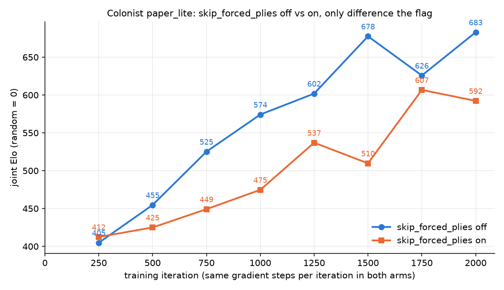
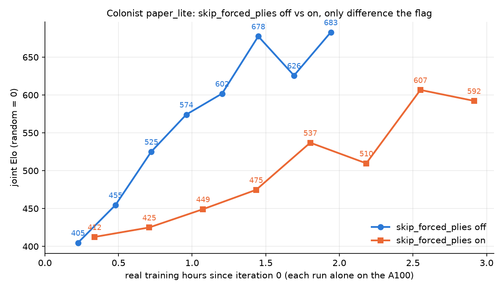

# Skipping forced moves (catanax #148 / #154): Elo by step and by real time

**Result:** in colonist paper_lite, playing forced moves inside the engine step (`skip_forced_plies=true`) trained a weaker agent than searching them, both per training iteration and per hour of real training. One seed per arm.

## Design

| | |
|---|---|
| Code | catanax `d2bdfff` (main + #154), one detached worktree, the same code for both arms |
| Recipe | `configs/colonist_paper_lite_normalized_anchor.yaml`, the same seed for both arms |
| The only difference | `skip_forced_plies=true` in the on arm. Everything else is the recipe's defaults, including the packing chunk sizes (`candidate_capacity` 0.4, `dice_capacity` 0.02) |
| Length | 2,000 iterations each, checkpoints every 250, evaluation only at iteration 0 |
| Order | off first, then on, each alone on one A100-SXM4-40GB. The runner waited for an idle GPU before each run, and `nvidia-smi pmon` was logged throughout (`pmon.log` isn't included here; it shows only the training processes) |
| Timing | every training-log line is prefixed with a Unix timestamp (`off.log`, `on.log`); hours are measured from iteration 0's line, so compile time is excluded |
| Evaluation | one joint round robin over both arms' 16 checkpoints plus a random player: 17 agents, 136 pairs, 512 games per pair (69,632 games), Bradley-Terry Elo with random = 0 |

## Results

| Iteration | Off: hours | Off: Elo | On: hours | On: Elo |
|---|---|---|---|---|
| 250 | 0.22 | 405 | 0.34 | 412 |
| 500 | 0.48 | 455 | 0.71 | 425 |
| 750 | 0.72 | 525 | 1.07 | 449 |
| 1000 | 0.96 | 574 | 1.43 | 475 |
| 1250 | 1.20 | 602 | 1.80 | 537 |
| 1500 | 1.45 | 678 | 2.18 | 510 |
| 1750 | 1.69 | 626 | 2.55 | 607 |
| 2000 | 1.94 | 683 | 2.91 | 592 |

- **Iteration time:** 3.50 s off, 5.25 s on.
- **Per iteration** (equal gradient steps), on trails from iteration 500 onward, by 30–170 Elo, at 7 of 8 checkpoints.
- **Per hour,** the gap is wider still.

## Why it's slower per hour too

Two effects multiply:

1. **Each iteration takes longer (5.25 s vs 3.50 s).** An iteration is always 1,400 self-play steps, but with forced moves played inside the engine, nearly every game in every step is at a real decision.
   - **Search load:** the one-ply search needs about 46% of its candidate slots per step, against about 21% with forced moves searched.
   - **Overflow:** the chunk sizes stayed at the off arm's values, so the on arm ran a second candidate and dice chunk on almost every step.
   - **Extra engine work:** the kernel also plays the forced moves.

   With chunks sized for it (0.5 / 0.04, measured in #154), the on arm's step is about 1.2× the off arm's instead of 1.5×.
2. **Each iteration teaches less.** An on iteration covers about twice as much real game, but the network still takes 60 gradient steps per iteration, and forced positions are no longer value-training samples.

Tuned chunk sizes fix only the first effect.

## Caveats

- **One seed per arm.** Single checkpoints swing (off: 678, 626, 683), but on trails at 7 of 8 checkpoints.
- **2,000 iterations** is about two thirds of the recipe's full 3,000.
- **Differs from an earlier, shorter check.** That one ran both arms at the same time on the GPU and used an earlier version of the forced-move rules (before the kernel was narrowed to rolls, END TURNs and discards). It suggested the on arm led early on. This sequential run supersedes it.

## Files

| File | Contents |
|---|---|
| `PLAN.md` | the plan as written before the runs |
| `run.sh` | the runner: worktree, idle-GPU wait, both arms, round robin |
| `round_robin.py` | the joint round robin |
| `off.log`, `on.log` | timestamped training logs |
| `timings.json` | per-iteration seconds since iteration 0, per arm |
| `round_robin.json`, `round_robin.log` | ratings, win and game matrices |
| `results.md` | the table above |
| `plot.py` | makes both plots and the table |
| `progress.log` | the runner's start and end times |
